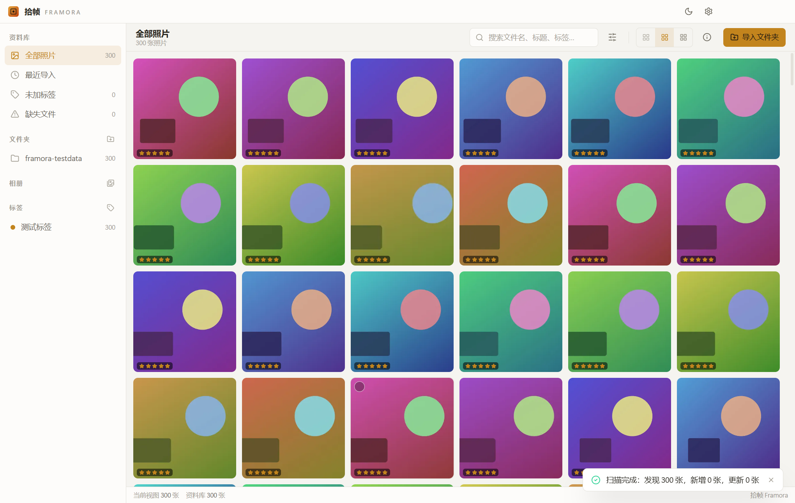

<div align="center">

# 拾帧 Framora

**面向 Windows 的本地写真照片管理软件**

快如拾帧，美若收藏。离线运行 · 数据不出本机 · 万级图片流畅浏览


|                  网格浏览（深色）                  |                   全屏查看器                   |
| :------------------------------------------------: | :--------------------------------------------: |
|        |          |
|                **详情与元数据面板**                |                  **浅色主题**                  |
|  |  |

</div>

---

## 目录

- [简介](#简介)
- [特性一览](#特性一览)
- [键盘快捷键](#键盘快捷键)
- [快速开始](#快速开始)
- [技术栈](#技术栈)
- [架构概览](#架构概览)
- [项目结构](#项目结构)
- [测试](#测试)
- [数据与隐私](#数据与隐私)
- [发布与更新](#发布与更新)
- [安全加固路线图](#安全加固路线图)
- [FAQ](#faq)
- [许可证](#许可证)

## 简介

拾帧 Framora 是一款完全离线运行的 Windows 本地照片管理软件：一次导入，即可获得覆盖
「检索整理 → 查看编辑 → 批量导出 → 存储治理」的完整照片库工作流。索引、缩略图与编辑备份
全部保存在本机 SQLite 与文件缓存中，不依赖任何云端服务；借助 SQLite 全文索引与虚拟化
渲染，万级图库也能流畅浏览、毫秒检索。

## 特性一览

### 导入与同步

- **批量导入，自动索引** — 一次选择文件夹，递归扫描全部子目录（JPG / PNG / WebP / GIF /
  BMP / AVIF / TIFF / RAW：CR2、CR3、NEF、ARW、DNG 等），按路径与修改时间去重，
  **重复导入零冗余**
- **拖放导入** — 从资源管理器直接拖入文件或文件夹：库内直接入库、库外复制，文件夹自动注册
  并扫描；也支持单张 / 多张文件导入，库外文件可复制入指定资料库文件夹
- **RAW 支持** — 显示与导出使用嵌入预览（不写回编辑）；HEIC/HEIF 因当前打包产物缺少
  HEVC 解码组件暂不支持，导入时会计数提示
- **自动同步** — 资料库文件夹持续监听，新增 / 修改 / 删除自动更新索引，删除标记「缺失」
  可恢复

### 检索与整理

- **多维检索** — 关键词（文件名 / 标题 / 描述 / 标签，支持中文）+ 日期范围 + 星级 +
  横竖方向 + 相机型号 + 五种排序，万级数据毫秒响应
- **组合筛选** — 工具栏筛选面板支持多标签（同时包含）/ 多相册 / 文件夹（任一）/
  仅未加标签
- **智能相册** — 搜索条件可保存为智能相册，之后可随时编辑名称与条件（多标签 AND、
  多相册 / 文件夹 OR、相机与方向、固定排序、可设颜色），照片新增或打标后自动动态更新
- **整理体系** — 星级评分、彩色标签、相册分组、标题描述，全部持久化本地
- **软删除与撤销** — 标签 / 相册 / 文件夹移除为软删除（保留全部照片关系），可在状态栏
  一键撤销；状态栏提供操作时间与撤销历史，撤销栈跨重启保留最近的可撤销删除

### 相似去重

- 感知哈希（dHash）自动聚类疑似重复照片，「重复照片」视图按簇排列
- 聚类使用 4×16 位分块索引（候选集为真实近邻超集，结果与逐簇扫描一致），十万张级图库仍在
  秒级完成
- 一键「保留最佳 / 保留最早」选中冗余项后批量清理

### 查看与编辑

- **全屏查看器** — 滚轮以光标为中心缩放（15%–800%）、拖拽平移、旋转翻转、胶片条快速切换、
  幻灯片放映（3s 循环轮播）
- **对比视图** — 双图并排同步缩放 + 焦点评分（恰好选中 2 张时按 C 进入）
- **基础编辑** — 亮度 / 对比度 / 饱和度 / 色温 / 色调 / 锐化 / 裁剪实时预览，保存写回原文件
  并自动备份；编辑历史保留最近 5 份，可恢复到任意版本
- **编辑预设** — 编辑调整可存为预设复用与管理（批量应用 / 删除）

### 批量操作

- Ctrl+A / Shift 范围选择，批量打星、加标签、入相册、按模板重命名、导出、删除
  （应用内回收站，可还原）
- 批量写入走集合语句、检索文本由后台脏队列分批刷新，万级批量操作毫秒级提交
- 照片可拖拽入相册 / 智能相册，也可拖出到系统

### 元数据与地图

- **EXIF** — 完整元数据面板（相机 / 镜头 / ISO / 光圈 / 快门 / GPS…）+ 应用内编辑
- **地点视图** — 以离线示意地图展示分布，支持框选区域——框内照片直接进入选择集，可批量
  评分 / 加标签 / 入相册

### 导出

- 格式（原格式 / JPEG / WebP / AVIF / PNG）、尺寸（原始至长边 800px）、质量可调
- 中心比例裁剪（1:1 / 4:3 / 16:9 等，不改原图）
- 文件名模板（{name} / {date} / {index}），重名自动改名不覆盖
- 文字水印可选

### 存储治理

- 设置页可视化索引库 / 缩略图 / RAW 预览 / 编辑备份占用与磁盘可用空间
- RAW 预览默认 1 GB、编辑备份默认 4 GB 预算，超限优先清理最旧缓存与较早历史版本
  （每张照片至少保留最近一份备份）
- RAW 预览按需重建，照片文件永不会被清理；缩略图生成失败的照片可在网格右键
  「重新生成缩略图」

### 界面

- 深浅双主题（暗室画廊风格，可跟随系统深浅色与减弱动效偏好）、无边框窗口
- 三档网格密度，虚拟化渲染万级图片不卡顿

## 键盘快捷键

随时按 <kbd>?</kbd> 打开应用内快捷键帮助浮层（与下表一致），<kbd>Esc</kbd> 关闭；
任何弹层（对话框、右键菜单、标签选择器等）打开时全局快捷键自动让位，避免误触。

**网格浏览**

| 按键         | 功能                                                          |
| ------------ | ------------------------------------------------------------- |
| Ctrl+A       | 全选当前视图照片                                              |
| Ctrl+Z       | 撤销最近一次移除（文件夹 / 标签 / 相册）                      |
| 方向键       | 移动选中项                                                    |
| 0–5          | 为所选照片评分（无选中时评锚点照片），0 清除                  |
| Enter / 空格 | 打开查看器（单选时）                                          |
| C            | 对比视图（恰好选中 2 张时）：←/→ 焦点、1-5 评分、滚轮同步缩放 |
| Delete       | 删除所选（确认后移入回收站）                                  |
| Esc          | 清除选择                                                      |
| 拖拽         | 拖入侧边栏相册 / 标签，或拖出窗口到资源管理器                 |

**查看器**

| 按键       | 功能                                                |
| ---------- | --------------------------------------------------- |
| ← / →      | 上一张 / 下一张                                     |
| 1–5        | 为当前照片评分                                      |
| Delete     | 移入回收站并继续下一张                              |
| Home / End | 第一张 / 最后一张                                   |
| i          | 信息面板                                            |
| r / R      | 预览向右 / 向左旋转 90°                             |
| + / − / 0  | 放大 / 缩小 / 复位缩放                              |
| F          | 切换全屏                                            |
| 拖拽       | 拖出窗口到资源管理器，或放回侧边栏相册              |
| 播放键     | 幻灯片放映（3s 循环轮播）                           |
| Esc / 空格 | 关闭查看器（放映中：空格暂停 / 继续，Esc 退出放映） |

## 快速开始

**环境要求**：Windows 10/11，Node.js ≥ 20（npm ≥ 10）；CI 在 Node 22 上运行。

> 国内网络加速建议把 npm / Electron 镜像配置在**用户级** `~/.npmrc`（registry 与
> electron 镜像等），仓库不再内置镜像配置，以保证 CI 环境稳定拉取。

```bash
npm install        # 安装依赖（自动生成应用图标）
npm run dev        # 开发模式（渲染进程热更新）
npm run typecheck  # TypeScript 全量类型检查
npm test           # 单元测试
npm run build      # 构建产物到 out/
npm run dist       # 打包 NSIS 安装包到 release/
```

打包产物：`release/Framora-<版本>-setup.exe`（NSIS 安装程序，支持自选目录 / 桌面与开始
菜单快捷方式）。

### 全部脚本

| 命令                  | 说明                              |
| --------------------- | --------------------------------- |
| npm run dev           | 开发模式（渲染进程热更新）        |
| npm run start         | 预览构建产物                      |
| npm run typecheck     | TypeScript 全量类型检查           |
| npm run lint          | ESLint 检查                       |
| npm run format        | Prettier 格式化                   |
| npm test              | 单元测试（Vitest）                |
| npm run test:coverage | 单元测试 + V8 覆盖率报告          |
| npm run build         | 构建主 / 渲染 / 预加载产物到 out/ |
| npm run dist          | 构建并打包 Windows 安装包         |
| npm run icon          | 生成应用图标                      |

### 原生模块说明

项目依赖 `better-sqlite3` 与 `sharp` 两个原生模块：

- **npm ≥ 12** 默认拦截安装脚本。若安装时出现 `install scripts blocked` 警告，执行：

  ```bash
  npm install-scripts approve better-sqlite3 electron sharp esbuild
  npm rebuild electron sharp esbuild
  ```

  （`package.json` 已内置 `allowScripts` 通配白名单，正常情况下无需手动操作。）

- `better-sqlite3` 需要匹配 Electron ABI 的预编译（本仓库已按 ABI 139 配置）。若重装依赖
  后启动报 ABI 不匹配，在 `node_modules/better-sqlite3` 下执行：

  ```bash
  npx prebuild-install -r electron -t <你的Electron版本> --verbose
  ```

- 无需 Visual Studio C++ 构建环境；打包配置已设 `npmRebuild: false`，直接使用 Electron
  ABI 预编译。

## 技术栈

| 层       | 选型                                 | 说明                                                                     |
| -------- | ------------------------------------ | ------------------------------------------------------------------------ |
| 框架     | Electron 38 + electron-vite          | 主进程 / 渲染进程 / 预加载一体化构建                                     |
| UI       | React 18 + TypeScript + Tailwind CSS | 组件化界面，深浅主题 CSS 变量驱动                                        |
| 状态     | Zustand                              | 轻量、可订阅；缩略图事件两级合批（主进程 250ms 聚合 + 渲染端 32ms 合批） |
| 索引     | better-sqlite3（SQLite WAL）         | 同步查询极快，全量万级查询 < 10ms，FTS5 trigram 中文全文检索             |
| 图像     | sharp（libvips）                     | 多核并行缩略图队列 + 编辑管线                                            |
| 元数据   | exifr                                | 高性能 EXIF 解析                                                         |
| 监听     | chokidar                             | 文件夹增量同步                                                           |
| 虚拟列表 | @tanstack/react-virtual              | 万级网格流畅滚动                                                         |
| 测试     | Vitest + CDP 冒烟                    | 12 个测试文件 203 项用例；puppeteer-core 驱动真实窗口冒烟                |
| 打包     | electron-builder（NSIS）             | Windows 安装包；electron-updater 应用内更新                              |

## 架构概览

```
┌──────────────────────────── Electron ────────────────────────────┐
│                                                                  │
│ 渲染进程：React 18 + Zustand                                     │
│   ├─ PhotoGrid 虚拟网格 / Viewer / Compare / Map / Sidebar       │
│   ├─ store.ts：单一 store（筛选 / 分页 / 选择 / 弹层 / 持久化）  │
│   └─ preload：contextBridge 白名单 channel（sandbox 隔离）       │
│                                                                  │
│             ▲ ▼   85 个 IPC channel（白名单 + 事件回推）         │
│                                                                  │
│ 主进程：Node.js                                                  │
│   ├─ scanner / watcher：递归扫描入库 + chokidar 增量同步         │
│   ├─ thumbs：多核缩略图队列（urgent / bulk，512px WebP）         │
│   ├─ phash：感知哈希 → 分块索引聚类（worker 线程执行）           │
│   ├─ imageops：sharp 编辑写回 / 批量导出 / 备份恢复              │
│   └─ db.ts：SQLite WAL + FTS5 trigram 全文索引 + 17 步迁移       │
│                                                                  │
└──────────────────────────────────────────────────────────────────┘
```

主进程数据链路：

```
chokidar 监听 ─► scanner 扫描入库 ─► thumbs 缩略图队列 ─► phash 感知哈希 ─► 分块聚类
                 │
                 ▼
               SQLite（WAL + FTS5 trigram 全文索引）◄──── 85 个 IPC channel ────► 渲染进程
```

- **安全模型** — sandbox + contextIsolation、windowOpen 一律拒绝；`media://` /
  `thumb://` 自定义协议仅放行库内与缓存路径（白名单校验）；preload 仅暴露白名单
  channel；生产 CSP 由构建期插件强校验
- **性能机制** — FTS5 trigram 全文检索、批量写入走 `json_each` 集合语句（不受 SQLite
  变量上限约束）、检索文本后台脏队列、缩略图事件两级合批、虚拟列表、RAW 预览 LRU 预算
  淘汰、感知哈希分块索引聚类（worker 线程执行）

## 项目结构

```
src/
├─ build/
│  └─ prodCsp.ts          生产 CSP 构建期校验
├─ main/                  主进程
│  ├─ index.ts            入口：窗口 / media://、thumb:// 协议 / 单实例 / 缓存预算
│  ├─ db.ts               SQLite 索引库（WAL + FTS5）：表结构 / 迁移 / 查询构建 / 备份迁移
│  ├─ scanner.ts          递归扫描 + 去重导入 + 单文件跟踪
│  ├─ watcher.ts          chokidar 增量同步
│  ├─ thumbs.ts           多核缩略图队列（urgent / bulk 双优先级，512px WebP）
│  ├─ phash.ts            感知哈希计算队列 + 启动补算
│  ├─ phashCore.ts        分块索引贪心聚类（纯函数，可单测 / 基准）
│  ├─ phashWorker.ts      worker 线程执行体
│  ├─ phashCluster.ts     聚类调度（worker_threads，避免阻塞 IPC）
│  ├─ exifmeta.ts         GPS / 相机型号存量补算队列
│  ├─ rawPreview.ts       RAW 全尺寸嵌入预览提取
│  ├─ previewService.ts   RAW 预览缓存：按需重建 / 预算淘汰 / 并发合并
│  ├─ imageops.ts         批量导出 / 编辑写回 / 备份恢复
│  ├─ undo.ts             撤销栈持久化（跨重启保留最近可撤销删除）
│  ├─ storage.ts          存储占用统计与预算清理
│  ├─ disk.ts             磁盘可用空间前置校验（防写一半 ENOSPC 半成品）
│  ├─ theme.ts            窗口首帧背景色（防白闪）
│  ├─ updater.ts          应用内更新（electron-updater）
│  ├─ log.ts              日志与保留天数清理
│  └─ ipc.ts              85 个 IPC 处理器（白名单模式）
├─ preload/
│  └─ index.ts            contextBridge：channel 白名单 + 拖放文件路径（sandbox 开启）
└─ renderer/
   └─ src/
      ├─ App.tsx          视图组织 / 全局快捷键 / 拖放导入 / 主进程事件订阅
      ├─ store.ts         Zustand 单一 store：筛选 / 分页 / 选择 / 弹层 / 持久化
      ├─ lib/             api 封装 / actions / 格式化
      └─ components/      标题栏 / 侧边栏 / 工具栏 / 虚拟网格 / 查看器 / 对比视图 /
                         地图 / 编辑面板 / 详情面板 / 批量栏 / 各对话框与弹层
scripts/                图标生成 / 测试数据生成 / UI 冒烟测试（CDP）
tests/                  12 个 Vitest 测试文件（主进程逻辑）
docs/screenshots/       界面截图
```

## 测试

```bash
# 单元测试（12 个文件 / 203 项用例，覆盖主进程全部纯逻辑）
npm test

# 覆盖率报告
npm run test:coverage

# 生成 300 张测试照片到系统临时目录
node scripts/gen-testdata.mjs 300

# 启动应用后运行 UI 冒烟测试（puppeteer-core 经 CDP 驱动真实窗口）
npx electron . --remote-debugging-port=9222
node scripts/ui-test.mjs 9222
```

UI 冒烟覆盖：导入去重、缩略图生成完成率、网格虚拟化渲染、查看器缩放、详情面板、关键词
检索、全选批量星级 / 标签、主题切换与持久化、疑似重复聚类与「保留最佳」、资源管理器拖放
导入、智能相册创建与编辑、存储预算治理，共 13 个截图检查点。

## 数据与隐私

- 全部数据保存在本机 `%APPDATA%\framora\`：`framora.db`（索引）、`thumbs\`（缩略图与
  RAW 预览缓存）、`backups\`（编辑备份）；RAW 预览与备份历史按设置页预算自动收敛，预览
  被清理后查看时按需重建
- 完全离线运行，不上传任何内容
- 删除 = 移入应用内回收站（文件保留原位置，可在回收站视图一键还原）；彻底删除 = 移入系统
  回收站；标签 / 相册 / 文件夹移除为软删除（保留全部照片关系），可在状态栏撤销；编辑有
  自动备份，均可恢复
- 索引库可在 设置 → 备份与迁移 中导出 / 导入单文件备份，换机时配合照片文件一起迁移；
  导入前会校验 schema 版本（拒绝更高版本）、核心表与完整性，通过同卷临时副本原子替换，
  失败自动回滚并重开原库

## 发布与更新

`npm version patch|minor|major` 提升 `package.json` 版本并自动创建 `v*` 标签，
`git push --follow-tags` 后 CI 先校验「标签 = package.json 版本」（不一致即失败，避免
产物版本停滞导致应用内更新静默失效），再构建并创建 GitHub Release（含安装包、
`latest.yml` 与 blockmap）。

应用内「设置 → 关于 → 检查更新」手动检查、下载（带进度 / 可取消）并安装重启，应用不主动
联网。

## 安全加固路线图

以下剩余项需要外部决策 / 采购（对应内部任务 OPT-51），当前构建链已就绪待接入：

1. **代码签名**（关闭「仓库被攻破即可向全体用户分发任意代码」的威胁面，同时消除
   SmartScreen 拦截）：
   - 采购证书：EV 代码签名证书，或 Azure Trusted Signing（GitHub Actions secrets 管理，
     按月计费更轻）
   - 在 release.yml 的 `Build installer` 步骤注入环境变量：`CSC_LINK`（证书文件或 blob
     URL）与 `CSC_KEY_PASSWORD`（electron-builder 原生识别，无需改 yml）
   - 在 `electron-builder.yml` 的 `win` 段添加 `publisherName: "<证书主体名>"`——注意：
     electron-updater 在配置了 publisherName 后会**强制校验签名**，未签名产物将无法通过
     应用内更新，两者必须同一次发布内同时生效
   - 可选：`forceCodeSigning: true` 使签名缺失时构建直接失败
2. **Electron 升级节奏**（当前 38 已退出官方三 major 支持窗口，Chromium 补丁停供）：
   - 建议每季度跟随 Electron 最新 major；升级前跑全量单测 + UI 冒烟（现有 203 项测试与
     ABI 139 预编译配置需同步更新）
   - `better-sqlite3` / `sharp` 的 Electron ABI 预编译按上文「原生模块说明」重装
3. **Electron Fuses**（可选加固）：`npm i -D @electron/fuses` 后在构建后脚本启用
   `onlyLoadAppFromAsar`、关闭 inspect 参数；`asar: true` 已显式声明，为 Fuses 就绪

## FAQ

**支持 HEIC / HEIF 吗？**
暂不支持：当前打包产物缺少 HEVC 解码组件，导入时会自动计数提示。其余主流格式（含
CR2 / CR3 / NEF / ARW / DNG 等 RAW）均已支持。

**启动时报 better-sqlite3 / sharp 的 ABI 不匹配？**
见「快速开始 → 原生模块说明」，在 `node_modules/better-sqlite3` 下执行
`npx prebuild-install -r electron -t <Electron 版本>` 重装预编译。

**数据保存在哪里？如何换机迁移？**
全部在本机 `%APPDATA%\framora\`。换机时在「设置 → 备份与迁移」导出单文件索引备份，配合
照片文件一起迁移，详见「数据与隐私」。

**会联网上传我的照片吗？**
不会。日常使用完全离线，唯一联网是「设置 → 关于 → 检查更新」手动触发的更新下载。

**RAW 文件会被编辑修改吗？**
不会。RAW 的显示与导出都使用嵌入预览，编辑 / 导出不写回 RAW 原文件。

**误删的照片 / 标签 / 相册能恢复吗？**
删除先进应用内回收站（可一键还原），彻底删除进系统回收站；标签 / 相册 / 文件夹移除是软
删除，状态栏可撤销（跨重启保留最近操作）；编辑自动保留最近 5 份备份。

## 许可证

[MIT](LICENSE)
