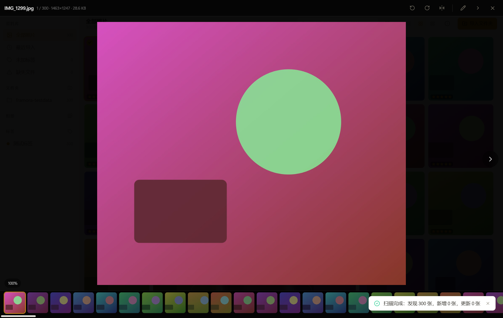
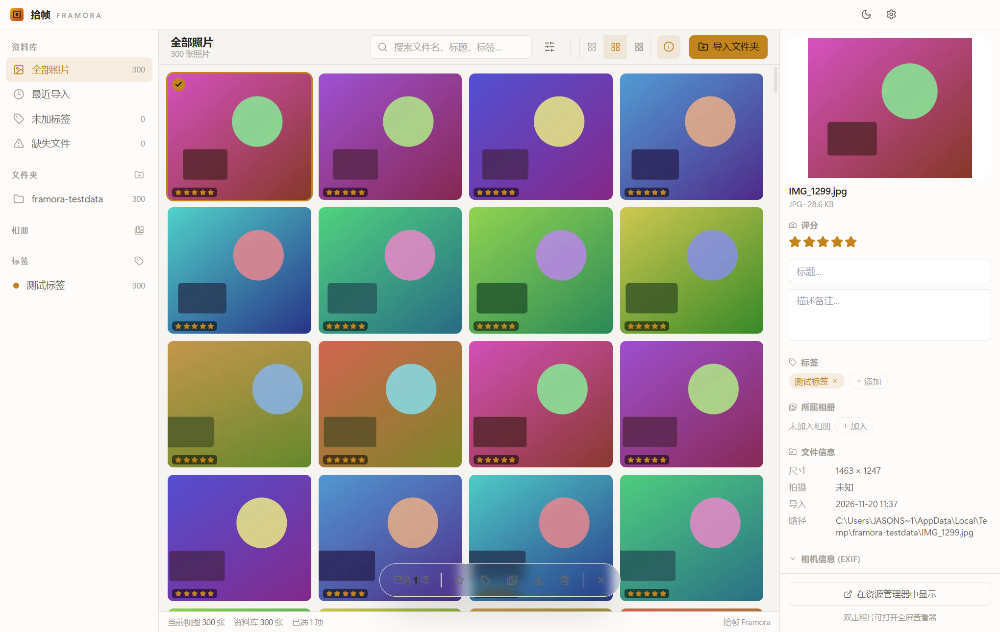
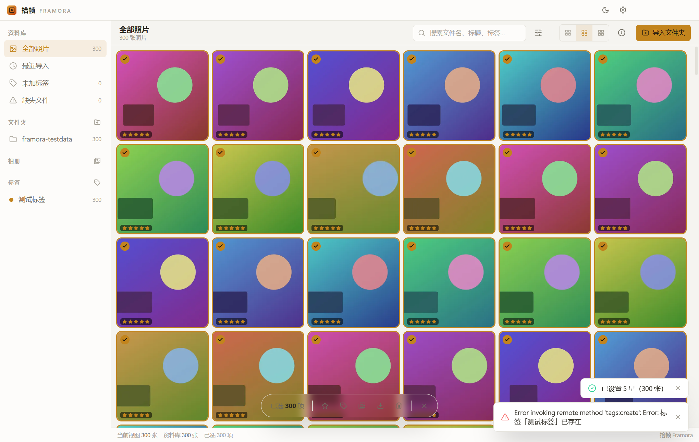

<div align="center">

# 拾帧 Framora

**面向 Windows 的本地写真照片管理软件**

快如拾帧，美若收藏。离线运行 · 数据不出本机 · 万级图片流畅浏览

</div>

<div align="center">

| 网格浏览（深色） | 全屏查看器 |
| :---: | :---: |
|  |  |
| **详情与元数据面板** | **浅色主题** |
|  |  |

</div>

---

## 特性一览

- **批量导入，自动索引** — 一次选择文件夹，递归扫描全部子目录（JPG / PNG / WebP / GIF / BMP / AVIF / TIFF / RAW：CR2、CR3、NEF、ARW、DNG 等），按路径与修改时间去重，**重复导入零冗余**；支持从资源管理器直接拖入文件或文件夹（库内直接入库、库外复制，文件夹自动注册并扫描）；也支持单张 / 多张文件导入，库外文件可复制入指定资料库文件夹。RAW 显示与导出使用嵌入预览（不写回编辑）。HEIC/HEIF 因当前打包产物缺少 HEVC 解码组件暂不支持，导入时会计数提示
- **自动同步** — 资料库文件夹持续监听，新增 / 修改 / 删除自动更新索引，删除标记「缺失」可恢复
- **多维检索** — 关键词（文件名 / 标题 / 描述 / 标签，支持中文）+ 日期范围 + 星级 + 横竖方向 + 相机型号 + 五种排序，万级数据毫秒响应；工具栏筛选面板支持多标签（同时包含）/ 多相册 / 文件夹（任一）/ 仅未加标签的组合筛选；搜索条件可保存为**智能相册**，之后可随时编辑名称与条件（多标签 AND、多相册 / 文件夹 OR、固定排序），照片新增或打标后自动动态更新
- **整理体系** — 星级评分、彩色标签、相册分组、智能相册（可设颜色）、标题描述，全部持久化本地；标签 / 相册 / 文件夹移除为软删除，可在状态栏一键撤销，状态栏提供操作时间与撤销历史
- **相似去重** — 感知哈希（dHash）自动聚类疑似重复照片，「重复照片」视图按簇排列；聚类使用 4×16 位分块索引（候选集为真实近邻超集，结果与逐簇扫描一致），十万张级图库仍在秒级完成；一键「保留最佳 / 保留最早」选中冗余项后批量清理
- **全屏查看器** — 滚轮以光标为中心缩放（15%–800%）、拖拽平移、旋转翻转、胶片条快速切换
- **基础编辑** — 亮度 / 对比度 / 饱和度 / 色温 / 色调 / 锐化 / 裁剪实时预览，保存写回原文件并自动备份；编辑历史保留最近 5 份，可恢复到任意版本
- **批量操作** — Ctrl+A / Shift 范围选择，批量打星、加标签、入相册、按模板重命名、导出、删除（应用内回收站，可还原）；批量写入走集合语句、检索文本由后台脏队列分批刷新，万级批量操作毫秒级提交；照片可拖拽入相册 / 智能相册，也可拖出到系统
- **元数据** — 完整 EXIF 面板（相机 / 镜头 / ISO / 光圈 / 快门 / GPS…）+ 应用内编辑；「地点」视图以离线示意地图展示分布，支持框选区域——框内照片直接进入选择集，可批量评分 / 加标签 / 入相册
- **灵活导出** — 格式（原格式 / JPEG / WebP / AVIF / PNG）、尺寸（原始至长边 800px）、中心比例裁剪（1:1 / 4:3 / 16:9 等，不改原图）、质量可调，文件名模板（{name} / {date} / {index}），重名自动改名不覆盖；编辑调整可存为预设复用与管理（批量应用 / 删除），文字水印可选
- **存储治理** — 设置页可视化索引库 / 缩略图 / RAW 预览 / 编辑备份占用与磁盘可用空间；RAW 预览默认 1 GB、编辑备份默认 4 GB 预算，超限优先清理最旧缓存与较早历史版本（每张照片至少保留最近一份备份）；RAW 预览按需重建，照片文件永不会被清理；缩略图生成失败的照片可在网格右键「重新生成缩略图」
- **现代界面** — 深浅双主题（暗室画廊风格，可跟随系统深浅色与减弱动效偏好）、无边框窗口、三档网格密度、虚拟化渲染万级图片不卡顿

## 技术栈

| 层 | 选型 | 说明 |
| --- | --- | --- |
| 框架 | Electron 38 + electron-vite | 主进程 / 渲染进程 / 预加载一体化构建 |
| UI | React 18 + TypeScript + Tailwind CSS | 组件化界面，深浅主题 CSS 变量驱动 |
| 状态 | Zustand | 轻量、可订阅；缩略图事件两级合批（主进程 250ms 聚合 + 渲染端 32ms 合批） |
| 索引 | better-sqlite3（SQLite WAL） | 同步查询极快，全量万级查询 < 10ms |
| 图像 | sharp（libvips） | 多核并行缩略图队列 + 编辑管线 |
| 元数据 | exifr | 高性能 EXIF 解析 |
| 监听 | chokidar | 文件夹增量同步 |
| 虚拟列表 | @tanstack/react-virtual | 万级网格流畅滚动 |
| 打包 | electron-builder（NSIS） | Windows 安装包 |

## 快速开始

**环境要求**：Node.js ≥ 20（npm ≥ 10）、Windows 10/11。

> 国内网络加速建议把 npm / Electron 镜像配置在**用户级** `~/.npmrc`（registry 与 electron 镜像等），仓库不再内置镜像配置，以保证 CI 环境稳定拉取。

```bash
npm install        # 安装依赖（自动生成应用图标）
npm run dev        # 开发模式（渲染进程热更新）
npm run typecheck  # TypeScript 全量类型检查
npm run build      # 构建产物到 out/
npm run dist       # 打包 NSIS 安装包到 release/
```

打包产物：`release/Framora-<版本>-setup.exe`（NSIS 安装程序，支持自选目录 / 桌面与开始菜单快捷方式）。

发布与更新：`npm version patch|minor|major` 提升 `package.json` 版本并自动创建 `v*` 标签，`git push --follow-tags` 后 CI 先校验「标签 = package.json 版本」（不一致即失败，避免产物版本停滞导致应用内更新静默失效），再构建并创建 GitHub Release（含安装包、`latest.yml` 与 blockmap）；应用内「设置 → 关于 → 检查更新」手动检查、下载（带进度/可取消）并安装重启，应用不主动联网。

### 发布安全加固清单（待外部资源，OPT-51 剩余项）

以下两项需要外部决策 / 采购，当前构建链已就绪待接入：

1. **代码签名**（关闭「仓库被攻破即可向全体用户分发任意代码」的威胁面，同时消除 SmartScreen 拦截）：
   - 采购证书：EV 代码签名证书，或 Azure Trusted Signing（GitHub Actions secrets 管理，按月计费更轻）
   - 在 release.yml 的 `Build installer` 步骤注入环境变量：`CSC_LINK`（证书文件或 blob URL）与 `CSC_KEY_PASSWORD`（electron-builder 原生识别，无需改 yml）
   - 在 `electron-builder.yml` 的 `win` 段添加 `publisherName: "<证书主体名>"`——注意：electron-updater 在配置了 publisherName 后会**强制校验签名**，未签名产物将无法通过应用内更新，两者必须同一次发布内同时生效
   - 可选：`forceCodeSigning: true` 使签名缺失时构建直接失败
2. **Electron 升级节奏**（当前 38 已退出官方三 major 支持窗口，Chromium 补丁停供）：
   - 建议每季度跟随 Electron 最新 major；升级前跑全量单测 + UI 冒烟（现有 197 项测试与 ABI 139 预编译配置需同步更新）
   - `better-sqlite3` / `sharp` 的 Electron ABI 预编译按 README「安装脚本与原生模块说明」重装
3. **Electron Fuses**（可选加固）：`npm i -D @electron/fuses` 后在构建后脚本启用 `onlyLoadAppFromAsar`、关闭 inspect 参数；`asar: true` 已显式声明，为 Fuses 就绪

### 安装脚本与原生模块说明

项目依赖 `better-sqlite3` 与 `sharp` 两个原生模块：

- **npm ≥ 12** 默认拦截安装脚本。若安装时出现 `install scripts blocked` 警告，执行：
  ```bash
  npm install-scripts approve better-sqlite3 electron sharp esbuild
  npm rebuild electron sharp esbuild
  ```
  （`package.json` 已内置 `allowScripts` 通配白名单，正常情况下无需手动操作。）
- `better-sqlite3` 需要匹配 Electron ABI 的预编译（本仓库已按 ABI 139 配置）。若重装依赖后启动报 ABI 不匹配，在 `node_modules/better-sqlite3` 下执行：
  ```bash
  npx prebuild-install -r electron -t <你的Electron版本> --verbose
  ```
- 无需 Visual Studio C++ 构建环境；打包配置已设 `npmRebuild: false`，直接使用 Electron ABI 预编译。

## 项目结构

```
src/
├─ main/            主进程
│  ├─ index.ts      入口：窗口 / 自定义协议（media://、thumb://）/ 单实例
│  ├─ db.ts         SQLite 索引库（WAL）：照片 / 标签 / 相册 / 智能相册 / 设置 / 查询构建
│  ├─ scanner.ts    递归扫描 + 去重导入 + 单文件跟踪
│  ├─ thumbs.ts     多核缩略图队列（512px WebP）+ EXIF 拍摄时间提取
│  ├─ phash.ts      感知哈希计算队列 + 启动补算（phashCore.ts 分块索引聚类，phashWorker.ts 在 worker 线程执行）
│  ├─ watcher.ts    chokidar 增量同步
│  ├─ imageops.ts   批量导出 / 编辑写回 / 备份恢复
│  └─ ipc.ts        IPC 处理器（白名单模式）
├─ preload/         上下文桥接（channel 白名单，sandbox 开启）
├─ renderer/        React 界面
│  └─ src/components/  标题栏 / 侧边栏 / 工具栏 / 虚拟网格 / 查看器 / 编辑面板 /
│                      详情面板 / 批量栏 / 导出与设置对话框
└─ shared/          前后端共享 TypeScript 类型
scripts/            图标生成 / 测试数据生成 / UI 冒烟测试（CDP）
docs/screenshots/   界面截图
```

## 测试

```bash
# 生成 300 张测试照片到系统临时目录
node scripts/gen-testdata.mjs 300

# 启动应用后运行 UI 冒烟测试（导入 → 缩略图 → 查看 → 检索 → 批量 → 主题）
npx electron . --remote-debugging-port=9222
node scripts/ui-test.mjs 9222
```

冒烟测试覆盖：导入去重、缩略图生成完成率、网格虚拟化渲染、查看器缩放、关键词检索、全选批量星级 / 标签、主题切换与持久化、查询性能基准。

## 数据与隐私

- 全部数据保存在本机 `%APPDATA%\framora\`：`framora.db`（索引）、`thumbs\`（缩略图与 RAW 预览缓存）、`backups\`（编辑备份）；RAW 预览与备份历史按设置页预算自动收敛，预览被清理后查看时按需重建
- 完全离线运行，不上传任何内容
- 删除 = 移入应用内回收站（文件保留原位置，可在回收站视图一键还原）；彻底删除 = 移入系统回收站；标签 / 相册 / 文件夹移除为软删除（保留全部照片关系），可在状态栏撤销；编辑有自动备份，均可恢复
- 索引库可在 设置 → 备份与迁移 中导出 / 导入单文件备份，换机时配合照片文件一起迁移；导入前会校验 schema 版本（拒绝更高版本）、核心表与完整性，通过同卷临时副本原子替换，失败自动回滚并重开原库

## 许可证

[MIT](LICENSE)
